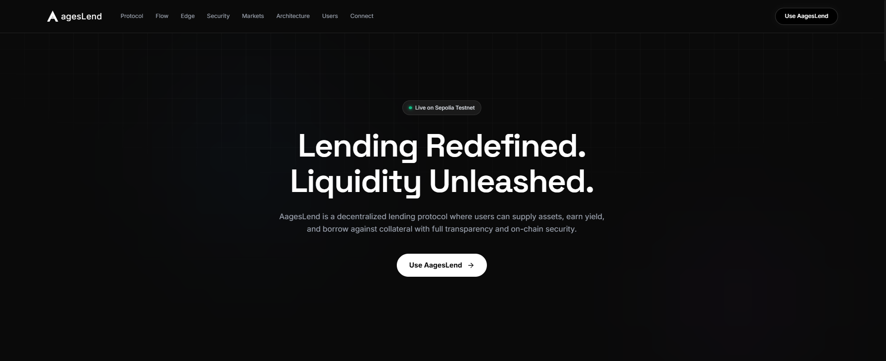
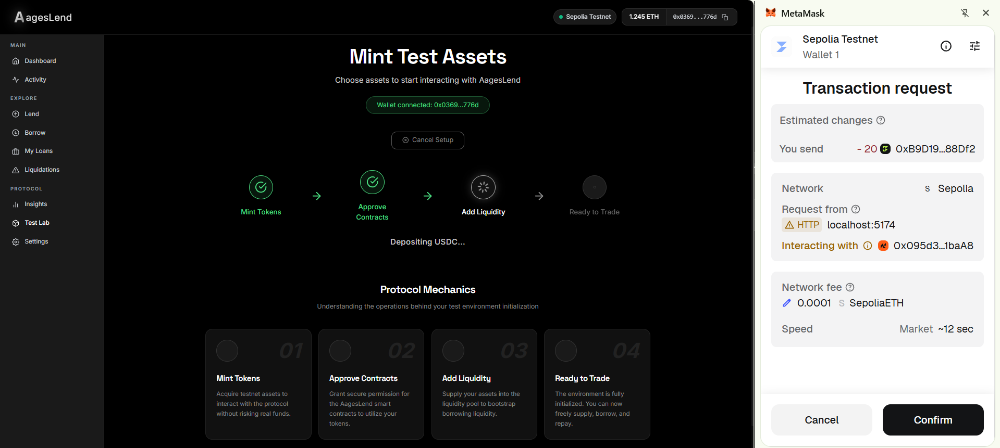
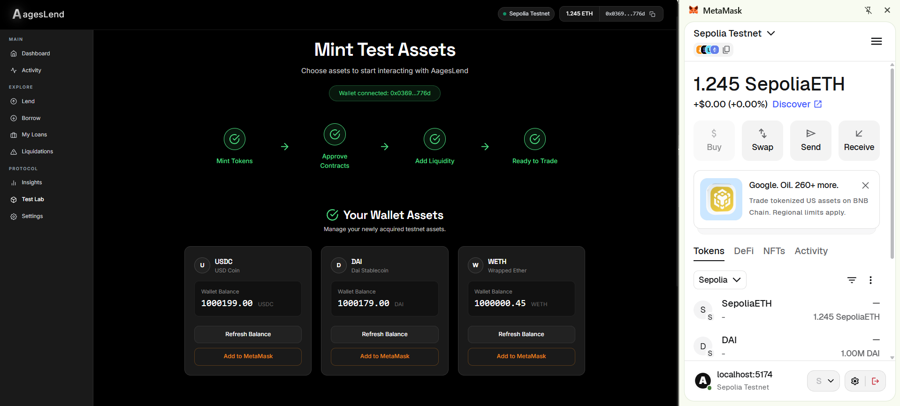
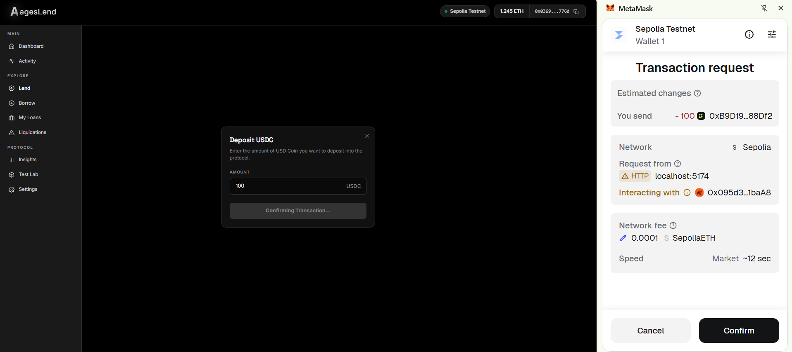
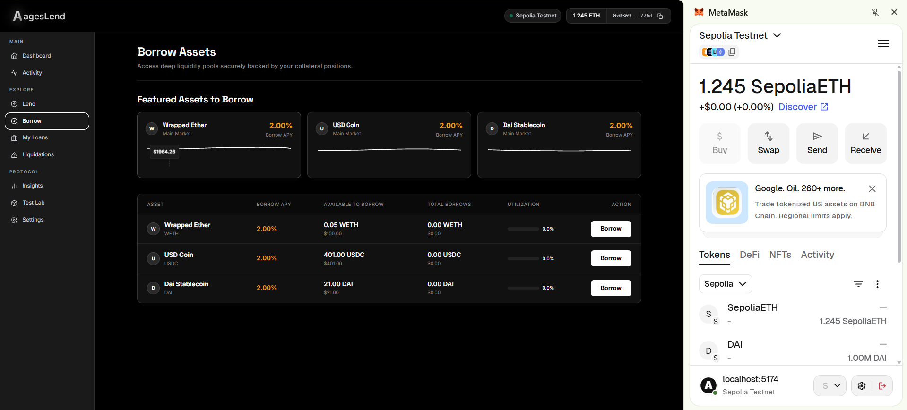
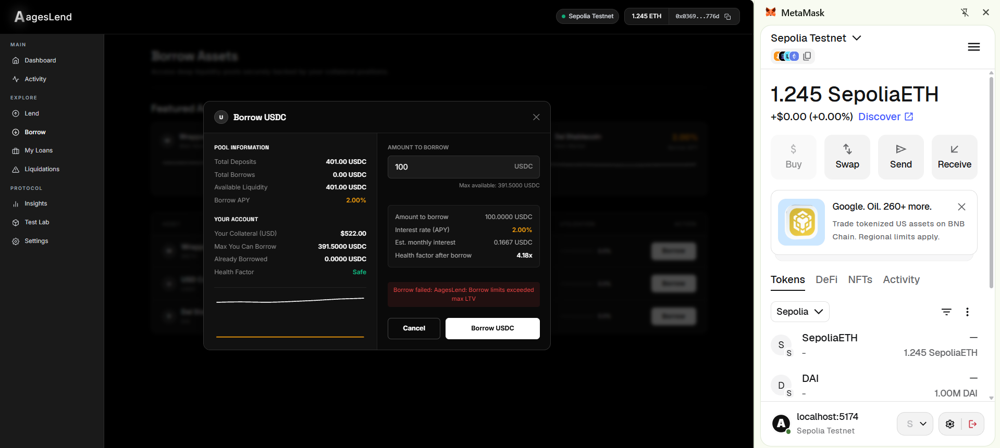
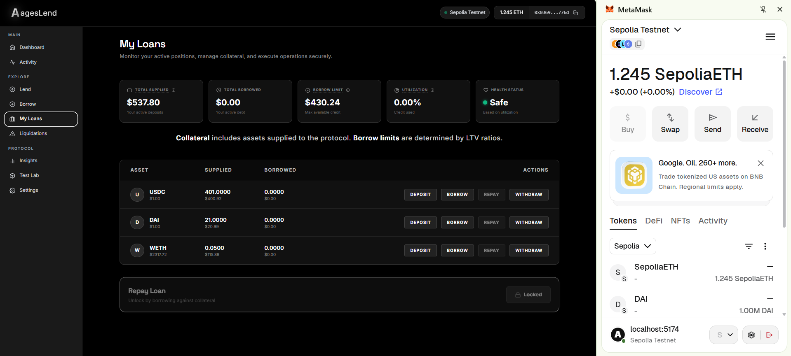
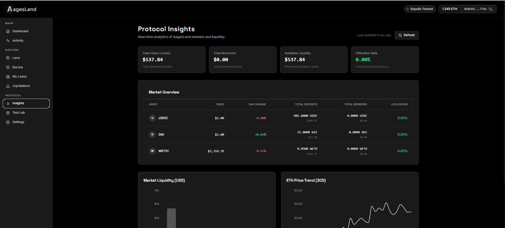

AagesLend Protocol – Guidelines

📌 Overview

AagesLend is a decentralized lending protocol built using Solidity and React.
It allows users to:

Mint mock tokens (USDC, DAI, WETH)
Deposit assets as collateral
Borrow assets based on Loan-To-Value (LTV)
Track loans and health factor

The system is deployed on Sepolia Testnet using mock tokens for safe testing.

⚙️ Tech Stack
Smart Contracts: Solidity (Hardhat)
Frontend: React (Vite)
Blockchain Interaction: Ethers.js
Wallet: MetaMask
Network: Sepolia Testnet
Deployment: Vercel

🚀 Core Features
ERC20 Mock Token Minting
Deposit & Borrow System
LTV-based borrowing logic
Wallet integration (MetaMask)
Real-time balance fetching
Health Factor calculation
Transaction feedback (success / error handling)

🧪 Mock Tokens (Test Assets)

Users can mint:

USDC
DAI
WETH

⚠️ These tokens have no real value and are only used for testing.

DASHBOARD : 

🔄 System Workflow

1. Mint Tokens
User clicks "Mint" in Test Lab
Tokens are minted using MockERC20
Tokens are directly sent to user wallet

2. Deposit Assets
User selects token and amount
Approves token
Deposits into smart contract

Stored in:

mapping(address => mapping(address => uint256)) deposits;

3. Borrow Assets
Requires:
Collateral deposited
Available liquidity in pool

Borrow logic:

maxBorrow = (collateralAmount * LTV) / 10000;

⚠️ Important Constraint (Very Important)

Even if a user deposits collateral, borrowing may FAIL.

Reasons:
No liquidity in pool
Token not supplied by other users
LTV limit exceeded

📊 My Loans Dashboard

Users can view:

Total Deposits
Borrowed Amount
Health Factor

🧠 How Liquidity Works (Key Concept)

This protocol uses a user-driven liquidity model:

Deposits from users = liquidity pool
Borrowing depends on available liquidity

❗ If no one deposits a token → it cannot be borrowed

This is a real DeFi behavior, not a bug.

❗ Known Limitations
No real Chainlink price feeds (mock / limited oracle)
No automatic liquidity provisioning
Borrow may fail due to empty pool
Liquidation logic is minimal
Some UI values are approximated (APY, utilization)

📁 Project Structure
contracts/
scripts/
frontend/
  └── src/
        ├── components/
        ├── pages/
        ├── utils/
screenshots/
GUIDELINES.md

🌐 Deployment
Smart Contracts → Sepolia Testnet
Frontend → Vercel

🚧 Future Improvements
Integrate Chainlink price feeds
Auto liquidity pool funding
Interest accrual system
Advanced liquidation engine
Better risk management

⚠️ Disclaimer

This project is built for educational purposes only.
Do NOT use real funds.

🎯 Recruiter Note 

If borrowing fails even after deposit:

👉 Reason:

Borrowing depends on liquidity availability.
Since this protocol uses user-supplied liquidity, borrowing fails when the pool is empty.

